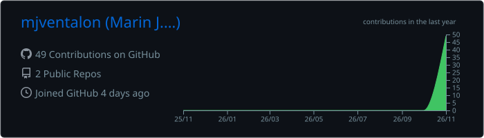
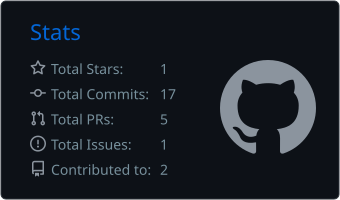
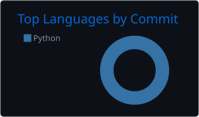

  

  
  
  

  

## 🚀 Featured project — [quantforge](https://github.com/mjventalon/quantforge)

An open-source quantitative-finance platform built on **real market data only**: a Python library,
a multithreaded **C++17 pricing engine**, a research web app, **paper trading** with $1M of virtual
money and an **Academy** with verifiable certificates.

- Option pricing: Black-Scholes, trees, Monte-Carlo, **Heston**, **SABR**, Merton jumps
- Portfolio optimisation, VaR/ES, stress tests on real crises, GARCH, backtesting lab
- ~23,000 lines · tested on Linux, macOS and Windows with GitHub Actions

  
  

## 🧰 Tech stack

  

## 📊 GitHub activity

  

  
  

  <picture>
    <source media="(prefers-color-scheme: dark)" srcset="https://raw.githubusercontent.com/mjventalon/mjventalon/output/snake-dark.svg">
    
  </picture>

---

Finance student who codes · building tools for markets and investing · always learning

